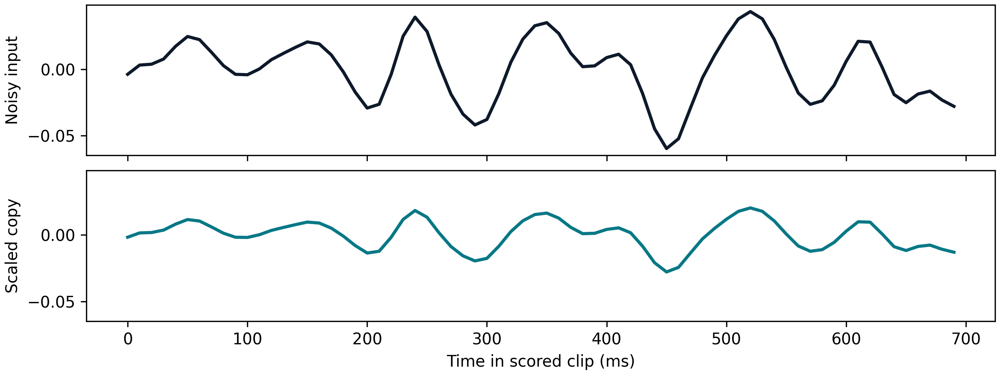

# Can a station denoiser recover fiber-optic earthquake arrivals?

We reproduced the released seisDAE station example, then tested the model on recorded DAS P arrivals. A scalar control exposes a pitfall: lowering amplitude earns ordinary SNR gain with identical waveform shape. On the fixed test the development-selected stretch improves shape, while a tuned spatial filter gives an even larger scale-invariant improvement at 0 dB. The 181-event cross-fitting experiment tests a different population.



**Read or present the project:** [Report PDF](reports_v3/report.pdf) · [Word](reports_v3/report.docx) · [Markdown](reports_v3/report.md) · [PowerPoint with notes](reports_v3/Presentation.pptx) · [PDF handout](reports_v3/Presentation.pdf) · [Timed talk and backup answers](reports_v3/TALK_SCRIPT.md).

## Main comparison

Mean ordinary / scale-invariant gain in dB, on the same 145 held-out earthquakes at 0 dB input. Classical revisions match context and tune settings. Neural revisions select stretch on out-of-fold development predictions.

| Method | Original gains (dB) | Revised gains (dB) |
| --- | --- | --- |
| Bandpass | -1.052 / -5.551 | 0.501 / -0.528 |
| f-k | 1.738 / -0.743 | 1.380 / 0.760 |
| Zero-shot | 0.078 / 0.053 | 0.491 / 0.256 |
| Fine-tuned | 0.397 / 0.135 | 0.553 / 0.269 |

## Verify the Windows download

After **Extract All**, open PowerShell in the extracted `seisdae-das` folder. With Python 3.12 installed, run:

```powershell
py -3.12 scripts/package_release.py --check
(Get-ChildItem src/v3 -Filter *.py).Count
```

The first command checks the SHA-256 manifest for every project file. The second prints **18** Python files, including `__init__.py`. Both checks work before installing TensorFlow.

## Run the project

From the extracted repository root on Linux or WSL2 with Conda installed:

```bash
sudo apt-get update
sudo apt-get install -y make pandoc libreoffice-writer libreoffice-impress poppler-utils
conda env create -f environment.yml
conda activate seisdae-das
make reproduce
```

Each run writes a fresh working copy under `runs/reproduction-*/`. The full CPU run verifies V2 and then regenerates the V3 experiments, executed analysis notebooks, report and deck, and checks numerical consistency. The prepared apertures, three recorded noise blocks, pretrained weights and derived conventional spectra are bundled. Installation needs network access. The normal rerun uses the bundled source cuts. On Windows, right-click the ZIP and choose **Extract All**. Open the report and slides directly in `reports_v3`. For the full build, use the setup above in Ubuntu on WSL2. To reproduce STEAD spectral extraction from the original public example, run `python -m src.v3.stead`. To redownload and extract the second DAS aperture, use `python -m src.v3.multi_data`. To refresh the two additional SCEDC cuts, use `python -m src.v3.noise --fetch`. These source commands require network access.

| Command | Purpose |
|---|---|
| `make test` | Run numerical, context, split and selection tests. |
| `make check` | Check the report, README, slide text, notes, embedded figures and viva against the canonical results-driven content. |
| `make assets` | Rebuild reports, figures and the deck using the existing CSVs. |
| `bash run_v2.sh` | Rerun the historical numerical benchmark in the current checkout. |
| `docker build -t seisdae-das .` then `docker run --rm seisdae-das` | Container entry point for the full run. |

Python 3.12, TensorFlow 2.16.2 and the numerical dependencies are pinned. See [direct dependencies](requirements-v2.txt), [Linux constraints](constraints-linux-py312.txt) and [the frozen experiment configuration](src/v3/protocol.json). Notebook execution uses IPython in-process on socket-restricted hosts. Conventional Jupyter users can run `jupyter nbconvert --to notebook --execute --inplace notebooks/*.ipynb`. For parallel V3 experiments on a multi-core machine, use `python scripts/reproduce.py --jobs 3`. Each independent run starts with an empty feature cache.

## Source and verification

The V3 release was reconstructed after the previous ZIP lost its final entries. All scientific modules, the figure and document generators, the experiment configuration, and regression tests are supplied here. The matched-budget objective and scratch-network experiments use newly measured results from the restored implementation. Historical V2 data are retained for comparison. See the final entry in [CHANGELOG.md](CHANGELOG.md) for the checks performed and differences from the earlier report.

## Find the evidence

| Question | Files in results_v3 |
|---|---|
| Were classical filters compared fairly? | classical_grid.csv, classical_selection.csv, classical_summary.csv, boundary.csv |
| Did stretch transfer? | stretch_cv_events.csv, stretch_selection.csv, stretch_summary.csv, stretch_strata.csv |
| How robust are measurement and intervals? | metric_checks.csv, clusters.csv, cluster_intervals.csv |
| Did the noise source or surrogate target matter? | external_events.csv, external_summary.csv, sensitivity_summary.csv, sensitivity_site.csv |
| Did objective and parameter count matter? | objective_fits.csv, objective_events.csv, objective_summary.csv |
| Does more training data help? | crossfit_roles.csv, crossfit_summary.csv, scratch_fits.csv, scratch_summary.csv |
| Why does the model act like the identity? | mechanism.csv, mask_example.npz, spectra.csv, stead_spectrum.csv |

[Study guide and glossary](STUDY_GUIDE.md) · [40 viva questions](VIVA_NOTES.md) · [Reviewer critique](REVIEWER_2.md) · [Data card](DATA_CARD.md) · [Model card](MODEL_CARD.md) · [Changelog](CHANGELOG.md) · [Credits and GPL license](NOTICE.md).

The fixed-test results use a field reference with residual noise. The all-event OOF results are a separate experiment and cannot be substituted for unseen-array validation. Earlier report versions are in `archive/`. A larger conventional STEAD/FDSN training run and an independent deployment study remain open.
