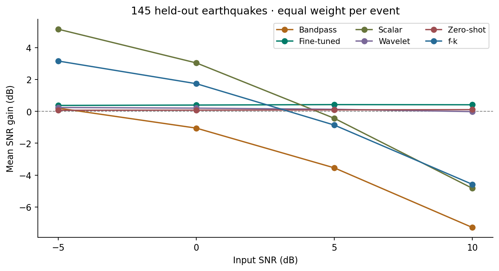
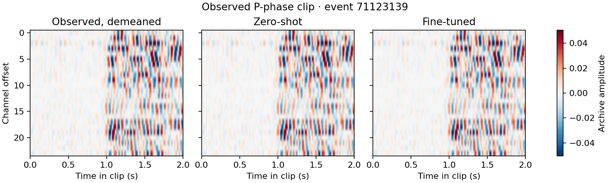

# Earthquake denoising with seisDAE on fiber-optic DAS records

Can a denoiser trained on conventional seismometers recover the P-wave arrival recorded by an optical fiber? This project tests the released seisDAE model, a version fine-tuned on DAS, and classical filters on the same recorded waveforms. DAS stands for distributed acoustic sensing. Each channel measures deformation along a short section of cable, so a passing earthquake can appear across neighboring channels.

**On 145 previously unused earthquakes**, fine-tuning improved mean SNR gain at all four noise levels. At 0 dB input, zero-shot seisDAE gained **0.08 dB**, the fine-tuned model **0.40 dB**, and the f-k filter **1.74 dB**. A training-fitted scalar achieved **3.04 dB** by reducing amplitude alone. The fine-tuned model had the highest mean gain at 5 and 10 dB input.



## Run it

From the extracted folder containing this README, create the Python 3.12 environment. The benchmark ran on Linux with CPU TensorFlow. On Windows, use these commands in a conda-enabled terminal in WSL2 for the closest match. The prepared waveforms and model weights are included. Only the environment installation needs network access for this workflow.

```bash
conda env create -f environment.yml
conda activate seisdae-das
python -m unittest discover -s tests -v
python -m src.evaluate --out runs/evaluation
python -m src.verify runs/evaluation
```

The evaluation scores 145 earthquakes at four noise levels with seven methods. The verifier compares all 4,060 event/method/SNR rows, the summaries, the paired confidence intervals and the example waveforms with the shipped results. CPU timing varies across runs. The CSVs can be opened directly in Excel. For a quick run of the classical methods, use `python -m src.evaluate --classical --out runs/classical`.

**Denoise an actual recording.** This command processes an observed two-second clip without adding noise. Open `runs/field/observed.png` to see the recorded and recovered waveforms on the same amplitude scale. The adjacent NPZ contains the observed array, both model outputs, the source event ID, sampling frequency and starting HDF5 row.

```bash
python -m src.field --event 71123139 --out runs/field
```



**Read or present the results.** [Study report](archive/v1/report.md) · [Verification record](results/verification.md)

## Data and event split

We used all 181 events in Jiaxuan Li's Long Valley and Ridgecrest DAS P-phase archive. Each HDF5 waveform array contains 200 samples per channel at 100 Hz. Long Valley has 4,670 rows and Ridgecrest has 4,718. The acquisition study describes 1–10 Hz filtering and common-mode removal. RMSE uses the archived numerical amplitude scale, whose physical calibration is unspecified. [Dataset](https://doi.org/10.22002/n47vy-s0s65) · [Acquisition study](https://doi.org/10.1038/s41467-023-39639-3)

| Array | Training | Validation | Earlier pilot test | New test | Total |
|---|---:|---:|---:|---:|---:|
| Long Valley | 12 | 3 | 3 | 133 | 151 |
| Ridgecrest | 12 | 3 | 3 | 12 | 30 |
| **Total** | **24** | **6** | **6** | **145** | **181** |

The earlier experiment used the 18 largest catalog magnitudes per array. Its six test earthquakes had already informed the study. We retained their `pilot` label and excluded them from the new comparison. **Every new test earthquake comes from outside the earlier 36-event experiment.** These are generally smaller events. Test magnitudes span 0.60–2.60 at Long Valley and 1.20–1.77 at Ridgecrest. Every channel from an earthquake shares its split. The new test is dominated by Long Valley, so we also report each array separately. [Event manifest](data/prepared/events.csv) · [Full archive inventory](data/prepared/inventory.csv)

## How the benchmark works

1. **Select an aperture.** For each event, take the highest median source-SNR block among eligible nonoverlapping blocks of 24 channels. Eligible blocks have consecutive channel IDs and a span of at most eight samples in the reported alignment shifts. Use relative shifts to place channels on a common local clock.
2. **Construct a reference and noise pair.** Read samples 9–78 and 86–155 inclusive on that clock as the early background and arrival reference, respectively. Demean each channel. The reference retains some field noise. The early window can contain weak signal. This selection focuses the benchmark on favorable apertures.
3. **Mix at known SNR.** For signal energy `E_s`, background energy `E_n` and requested SNR `L` in dB, multiply the background by `sqrt(E_s / (E_n × 10^(L/10)))`. A single factor per aperture preserves relative amplitudes across channels. Reuse the same background across levels for paired comparisons.
4. **Run the methods.** seisDAE expects 6,001 samples, so we center each 70-sample trace in zeros. The model estimates a time-frequency mask. Only the 70 observed samples enter scoring. f-k uses all 24 channels together. The other denoisers process traces individually.
5. **Score by earthquake.** Report SNR gain, waveform correlation, RMSE in archive units and normalized RMSE. Compare STA/LTA threshold-crossing times on the estimate and proxy reference. Report pick recovery alongside mean error. Each earthquake gets one vote in the mean gain, regardless of recorded amplitude.

| Method | Implementation |
|---|---|
| Noisy input | Identity control with exactly 0 dB gain |
| Scalar | A single multiplier fitted on the 24 training events across all four noise levels. The same multiplier is used on every test input. |
| Bandpass | Third-order 1–10 Hz Butterworth, applied forward and backward |
| Wavelet | db8 transform, median absolute deviation noise estimate and soft thresholding |
| f-k | Frequency–wavenumber fan filter on the local common clock, nominal 10 m spacing and a 500 m/s cutoff with tapered edges |
| Zero-shot seisDAE | Released GR checkpoint trained on conventional seismometer records |
| Fine-tuned seisDAE | Same checkpoint with 16 fitted weights in the final signal/noise mask layer. Validation cross-entropy selects the saved epoch. |

## Measured results

**Mean SNR gain in dB.** A positive value means less waveform error relative to the arrival reference. A negative value means the method increased that error. Column labels give the SNR of the input mixture.

| Method | −5 dB input | 0 dB input | 5 dB input | 10 dB input |
|---|---:|---:|---:|---:|
| Noisy | 0.00 | 0.00 | 0.00 | 0.00 |
| Scalar | **5.15** | **3.04** | -0.44 | -4.83 |
| Bandpass | 0.20 | -1.05 | -3.55 | -7.29 |
| Wavelet | 0.24 | 0.20 | 0.13 | -0.01 |
| f-k | 3.16 | 1.74 | -0.86 | -4.58 |
| Zero-shot | 0.07 | 0.08 | 0.09 | 0.11 |
| Fine-tuned | 0.37 | 0.40 | **0.42** | **0.41** |

At 0 dB, fine-tuning improved on zero-shot in **145 of 145 events**. The mean paired improvement was **0.319 dB** with a **95% bootstrap interval of 0.296–0.345 dB**. We resampled entire earthquakes 5,000 times within each array, preserving their observed proportions. These intervals describe event-to-event variation on the two sampled arrays.

**Interpretation.** A constant multiplier can improve SNR by reducing amplitude while leaving waveform correlation unchanged. Compare gain with correlation, timing and the scalar control before attributing an improvement to signal recovery. The 0.70 s scoring window is shorter than the checkpoint's 0.99 s STFT window. Padding supplies input dimensions but adds no recorded context. Continuous-record performance and the accuracy of absolute earthquake arrival times require separate measurements.

| Result file | What to inspect |
|---|---|
| [summary.csv](results/summary.csv) | Gain, CC, RMSE, normalized RMSE, pick recovery, timing error and CPU time for each method and level |
| [by_array.csv](results/by_array.csv) | Compare the same metrics between the 133 Long Valley events and 12 Ridgecrest events |
| [paired_gain.csv](results/paired_gain.csv) | Mean within-event gain differences, bootstrap intervals and counts of event-level wins |
| [per_event.csv](results/per_event.csv) | Every scored event and mixture, including the numbers of reference and matched picks |

## Rebuild from source

Run commands from the repository root. To rebuild all prepared apertures, `src.data` downloads the original 701.4 MB archive and verifies its published MD5. If you already extracted it, use `python -m src.data --raw /path/to/CaltechDATA --out runs/prepared`.

```bash
python -m src.data --out runs/prepared
python -m src.train --data runs/prepared --out runs/refit
python -m src.evaluate --data runs/prepared --head runs/refit/das_head.npz --out runs/refit_eval
python -m src.verify runs/refit_eval
python -m src.figures --results runs/refit_eval --models runs/refit --out runs/figures
```

To process rows from any event in the publisher's archive, select the first HDF5 row and count explicitly. For example, rows 3552–3575 reproduce the bundled field demonstration.

```bash
python -m src.field --h5 data/raw/CaltechDATA/phase_P/71123139.h5 --first-row 3552 --count 24 --out runs/field_h5
```

For the original seismometer example, run `python -m src.reproduce`. For a side-by-side check against the upstream predictor and the optional from-scratch STEAD/FDSN training recipe, see the [source-training record](results/source_training/README.md). The small STEAD/FDSN pilot checkpoint is separate from the released GR checkpoint used in the main comparison.

## Code and notebooks

| Directory | Contents |
|---|---|
| `src/` | Archive preparation, STFT/model adapter, training, field inference, filters, metrics, evaluation, figures and verification |
| `notebooks/` | Seven ordered notebooks covering reproduction, data exploration, mixing, frozen inference, classical baselines, fine-tuning and results |
| `data/`, `models/` | Prepared event arrays, source-example trace, published checkpoint, fitted output weights and source-training pilot |
| `scripts/`, `tests/` | Optional source-training tools and regression tests |
| `figures/`, `results/`, `archive/v1/` | Measured outputs, figures and presentation materials |

Open the walkthrough with `jupyter lab notebooks`. If using pip instead of conda, install `requirements.txt` into a Python 3.12 environment and install JupyterLab separately for the notebooks. [Credits, licenses and pinned upstream revision](NOTICE.md)
