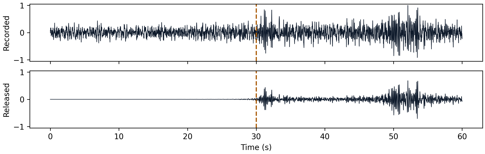
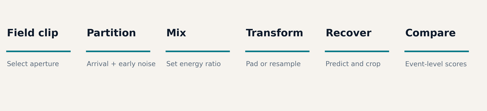
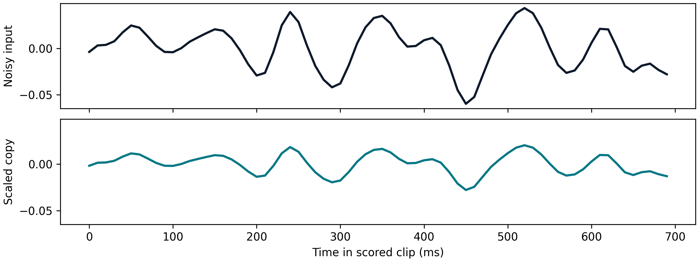
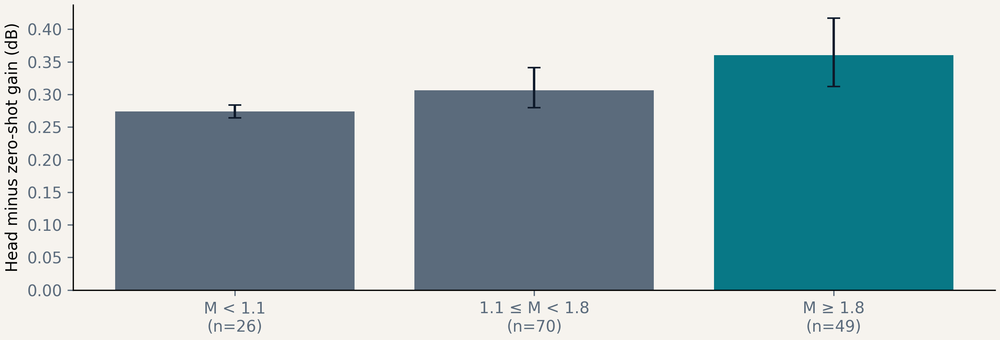
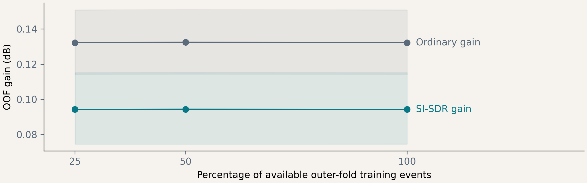
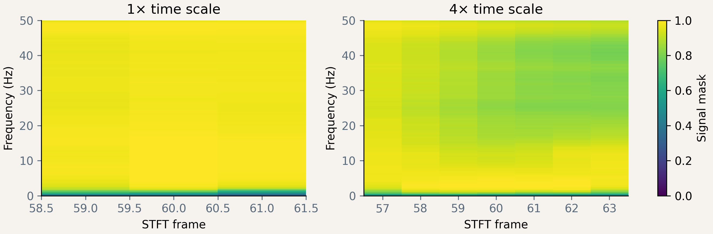
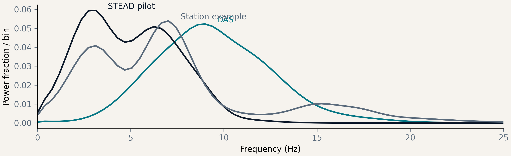

# Recovering earthquake arrivals on optical fiber

Shantanu  ·  AI/ML Course Project · IIT Roorkee
Instructor: Not specified  ·  10 November 2026

> An optical fiber records a passing earthquake at many positions.  
> A station-trained denoiser changes these short arrivals only slightly.  
> Turning down the amplitude can improve the usual error score.  
> A second score tests whether the waveform shape also improved.  
> A spatial filter preserved the most shape among the revised controls at equal signal and noise energy.

## Abstract

We reproduced one published seisDAE station prediction and evaluated transfer on a fixed cohort of 145 DAS earthquakes. At 0 dB input the original adapted head achieved 0.397 / 0.135 dB ordinary / scale-invariant gain. A development-selected time stretch raised those gains to 0.553 / 0.269 dB. A development-selected f–k filter achieved 1.380 / 0.760 dB. The smaller magnitude group improved less than the larger group. The evaluation uses noisy field references and two previously seen fibers.

## 1  Introduction and related work

A seismometer measures motion at a station. DAS measures axial deformation along a cable, with sensitivity to orientation and local coupling. Zhu and colleagues and Tibi and colleagues studied learned seismic denoisers. Heuel and Friederich applied an autoencoder to noise suppression; Steinberg and colleagues examined denoising in regional waveform analysis. Here the question is whether the released GR checkpoint preserves field P arrivals after transfer to a different sensor.

The assignment has two parts. For reproduction, we compare the local adapter with the upstream prediction on the published station trace. For the open-data application, we construct controlled mixtures from Caltech DAS arrivals. The study adds waveform-shape metrics, spatial controls, cross-fitting and independent noise recordings.

## 2  Data and reproduction

Li’s Caltech P-phase collection supplies 181 earthquakes, 151 from Long Valley and 30 from Ridgecrest. The released two-second windows were already filtered at 1–10 Hz and common-mode suppressed. On each event the original pipeline selects the highest-median-SNR eligible 24-channel block, requiring consecutive channel IDs and at most eight samples of shift spread. That selection favors visible arrivals.

## 3  Method

Published shifts set relative channel timing. Samples 86–155 supply the reference and 9–78 the earlier background, with zero-based indices. One noise multiplier per aperture sets −5, 0, 5 or 10 dB input SNR. The 70-sample observation is centered in 6,001 samples. The released checkpoint estimates a two-class STFT mask; inverse transformation recovers the center. The original adaptation fits only the final output map.

## 4  Evaluation design

The fixed split uses 24 training events, six validation events, six excluded earlier pilot events and 145 test events. Earthquakes never cross within an experiment. V2 test results were already public to this project. New candidate selection used development events alone. Separately labeled population cross-fitting includes every event, with its own disjoint outer-fold predictions.

Ordinary gain is the logarithm of the ratio of input and output squared residual energy. Zero-mean SI-SDR projects each estimate onto the reference; its gain is the change from the same noisy input. Signed correlation, local peak ratio, an automated first-excursion sign and matched STA/LTA pick error measure different properties. The reference still contains field noise.

Table 1. Synthetic metric controls. One fixed pulse per condition. SI-SDR is an absolute value; perfect alignment saturates at the numerical ceiling.

| Condition | SI-SDR (dB) | Peak ratio | Sign | CC |
| --- | --- | --- | --- | --- |
| perfect | 120.000 | 1.000 | 1 | 1.000 |
| sign flip | 120.000 | 1.000 | 0 | -1.000 |
| scale 0.5 | 120.000 | 0.500 | 1 | 1.000 |
| shift 5 samples | -38.946 | 1.006 | 1 | -0.011 |

A sign flip preserves the scale-invariant score while reversing signed correlation. The delayed pulse retains its first-excursion sign despite poor shape agreement. We retain that sign only as a diagnostic proxy and make no analyst-polarity claim.

## 5  Results

## 5.1  Matched context changes the classical comparison

Table 2. Fixed 145-event benchmark at 0 dB. Each entry is ordinary / SI-SDR gain in dB. Revised neural rows use the selected stretches.

| Method | Original gains | Revised gains |
| --- | --- | --- |
| Scalar | 3.041 / -0.000 | Same control |
| Bandpass | -1.052 / -5.551 | 0.501 / -0.528 |
| Wavelet | 0.203 / -0.188 | 0.325 / -0.420 |
| f-k | 1.738 / -0.743 | 1.380 / 0.760 |
| Zero-shot | 0.078 / 0.053 | 0.491 / 0.256 |
| Fine-tuned | 0.397 / 0.135 | 0.553 / 0.269 |
| Median stack | — | -0.213 / -15.453 |
| SVD | — | 0.393 / -0.391 |

The development grid covers passbands, wavelet strengths, f–k fan velocities and truncated SVD ranks. We select by mean ordinary gain over all development events and all four noise levels. Each temporal filter receives the padded 6,001-sample context and returns only the center. Zero columns leave spatial SVD and the median stack unchanged inside that center. The wavelet estimates noise on real samples.

With the 1–10 Hz band fixed, the development short-window bandpass gave 0.563 / -4.040 dB at 0 dB; the padded version gave 1.576 / -2.234 dB. Filtering boundaries therefore matter. The revised test result also changes the cutoffs, so the whole test difference cannot be attributed to padding alone.

The revised f–k filter had SI-SDR gain 0.760 [0.616, 0.897] dB (95% event-bootstrap interval). It achieved the highest shape gain among the fixed-test controls shown here.

## 5.2  Event grouping tests the uncertainty

Table 3. Paired head-minus-released intervals, 145 test events. Connected components link same-site events within two days and ten kilometres.

| Resampling | Units | Gain 95% CI (dB) | SI 95% CI (dB) |
| --- | --- | --- | --- |
| cluster | 78 | [0.294, 0.347] | [0.063, 0.103] |
| event | 145 | [0.297, 0.344] | [0.063, 0.101] |

The cluster intervals still favor the head. The proximity rule describes possible dependence and does not identify geological families.

## 5.3  Small events and artificial context

The low-minus-high magnitude contrast is -0.087 dB [-0.144, -0.038]. Both extreme bins contain only Long Valley events. Smaller earthquakes benefit less under this comparison; the design cannot separate magnitude from source SNR or establish the same effect in Ridgecrest.

We compared factors 1, 2, 4 and 8 in three event-grouped development folds. Each outer score prediction used a head fitted and stopped away from that event. We chose the factor separately for each model by mean out-of-fold SI gain across all four levels. Stretching changes apparent frequencies; it adds no physical context.

Table 4. Held-out stretch results at 0 dB, 145 events. Brackets give within-site event-bootstrap intervals.

| Model | Factor | Ordinary gain (dB) | SI gain (dB) |
| --- | --- | --- | --- |
| Fine-tuned | 2 | 0.553 [0.480, 0.635] | 0.269 [0.237, 0.304] |
| Zero-shot | 4 | 0.491 [0.387, 0.612] | 0.256 [0.220, 0.292] |

The best validation-only factor from V2 did not transfer as a universal setting. The head selected factor 2, while the released model selected factor 4. Both improved shape on the fixed test cohort. All levels and magnitude strata are in stretch_strata.csv.

## 5.4  Independent backgrounds and reference choices

Table 5. Matched 12 Ridgecrest test targets at 0 dB. External rows average three disjoint 70-sample cuts per target from the indicated UTC hour.

| Background | Ordinary gain (dB) | SI gain (dB) |
| --- | --- | --- |
| Original early window | 0.422 | 0.151 |
| 2020062417 | 0.305 | 0.148 |
| 2020062506 | 0.338 | 0.194 |
| 2020062619 | 0.325 | 0.134 |

The earlier three-event validation probe lost shape gain with one SCEDC excerpt. In this larger, differently composed comparison the original head averages 0.159 dB SI gain across three external recordings versus 0.151 dB on the same test targets with their original backgrounds. The earlier drop did not repeat on average. Three source hours still give little information about variability across days.

The source cuts begin ten minutes into each UTC hour on contiguous trace rows 400–423. Each 30-second block is detrended and differentiated, channel-median subtracted, filtered at 1–10 Hz and resampled from 250 to 100 Hz. Each event reuses the three fixed offsets. These are background candidates without independent earthquake screening; repeated target–cut pairs are not independent noise days.

## 5.5  Sensitivity to the surrogate target

Table 6. Exploratory fixed-head results at 0 dB. The subset uses the original noisy mixtures. Other conditions rebuild the mixture.

| Condition | Events | Ordinary gain (dB) | SI gain (dB) |
| --- | --- | --- | --- |
| alternate early | 145 | 0.361 | 0.113 |
| source at least 35 dB | 23 | 0.686 | 0.256 |
| stack target | 145 | 0.349 | 0.077 |

The alternate early window takes the first 70 samples of each original row. The aligned-stack target repeats the median reference across channels. The positive shape gains depend on target definition and selection quality; a stack does not supply independent clean truth.

## 5.6  Parameter count and training objective

Table 7. Development OOF scores at 0 dB, 30 earthquakes. All architectures see the same training traces, learning rate, batch size and update budget.

| Model and loss | Weights | Steps | Gain (dB) | SI (dB) |
| --- | --- | --- | --- | --- |
| Decoder / mask CE | 608 | 144 | 0.278 | 0.250 |
| Decoder / waveform NMSE | 608 | 144 | 0.280 | 0.251 |
| Head / mask CE | 16 | 144 | 0.240 | 0.218 |
| Head / waveform NMSE | 16 | 144 | 0.240 | 0.218 |

The waveform objective differentiates through the inverse STFT on the recorded center and normalizes the error per trace. Each fit uses the same mini-batch sequence and selects weights using inner validation events. Table 7 reports the reconstructed training experiment. Its estimates apply to the stated update budget and the development cohort.

## 5.7  Cross-fitting with two apertures per earthquake

Fold-stratified fitting uses nested subsets and 40 full-batch updates for a shared output head. Every channel and level contributes, with every twelfth frequency bin sampled for training. The full-size head gains 0.132 / 0.094 dB. Increasing the event count has little effect under this fixed schedule.

A newly trained compact residual U-Net from scratch on the same full-size fold assignments gains 3.333 / 0.729 dB. Its SI interval is 0.729 [0.619, 0.829] dB. The interval describes uncertainty across earthquakes in these two arrays. These OOF estimates include the former pilot and test IDs in different training folds; they are separate from the fixed 145-event benchmark.

## 6  Why the released network changes little

On event 71123139, the energy-weighted mask is 0.997 in the original encoding. The relative waveform change ‖output − input‖ / ‖input‖ is 0.017. After fourfold stretching, these become 0.981 and 0.052. Energetic bins mostly pass on this example. It is one mechanism illustration, not proof of a universal filter.

The DAS product was prefiltered and the sensors measure different quantities. These curves compare spectral shape. The STEAD pilot is documented conventional training material; the exact released GR training population is unavailable here, so it cannot be reconstructed from these spectra.

## 7  Limitations

Highest-SNR aperture selection, field noise in the target, previously seen fibers, imbalanced sites and short clips restrict external validity. Even cluster resampling assumes independent operational groups. The external noise study reuses three source blocks across earthquakes. Source magnitude, acquisition site and signal quality covary. Timing and first-excursion scores use automatic references and cannot establish detection recall or focal-mechanism accuracy.

Two apertures per event increase spatial coverage but leave much of each fiber unobserved. The all-event OOF head uses a different optimizer and frequency subsampling from the historical head. A fair objective comparison fixes the budget but explores one budget only. Shrinkage remains an important explanation for some large ordinary gains.

## 8  Conclusions and future work

The original head gives a small, reproducible shape improvement. Selecting the time scaling on development folds improves it further. A tuned spatial filter provides a stronger comparison, and the independently sampled backgrounds do not reproduce a universal loss of shape gain. An unseen fiber, additional independent noise days and manually checked arrivals would be the most informative next evaluation. Larger conventional STEAD/FDSN retraining remains future work.

## References

Course-list entry: Steinberg et al. (2023), *Neural Network Based Denoising of Regional Seismic Waveforms and Impact on Analysis of North Korean Nuclear Tests*. The journal record below supplies the published title and dates.

Steinberg et al. Deep Neural Networks Based Denoising of Regional Seismic Waveforms and Impact on Analysis of North Korean Nuclear Tests. Published online 2024, journal volume 182 (2025). https://doi.org/10.1007/s00024-024-03491-3

Heuel & Friederich (2022). Suppression of wind turbine noise from seismological data using nonlinear thresholding and denoising autoencoder. https://doi.org/10.1007/s10950-022-10097-6

Zhu, Mousavi & Beroza (2019). Seismic signal denoising and decomposition using deep neural networks. https://doi.org/10.1109/TGRS.2019.2926772

Tibi et al. (2021). Deep Learning Denoising Applied to Regional Distance Seismic Data in Utah. CTBT Science and Technology Conference. https://conferences.ctbto.org/event/7/contributions/1145/

Li, Zhu, Biondi & Zhan (2023). Earthquake focal mechanisms with distributed acoustic sensing. https://doi.org/10.1038/s41467-023-39639-3

Li (2023). Caltech DAS P-phase dataset. https://doi.org/10.22002/n47vy-s0s65

Mousavi et al. (2019). STanford EArthquake Dataset (STEAD). https://doi.org/10.1109/ACCESS.2019.2947848

Li et al. (2021). Rapid Response to the 2019 Ridgecrest Earthquake With Distributed Acoustic Sensing. https://doi.org/10.1029/2021AV000395

## Appendix  Evidence and reproduction

Table 8. Held-out results across input conditions. Each cell is ordinary / SI-SDR gain in dB on the same 145 earthquakes.

| Input (dB) | Revised f–k | Released + stretch | Head + stretch |
| --- | --- | --- | --- |
| -5 | 1.589 / 0.956 | 0.531 / 0.233 | 0.538 / 0.218 |
| 0 | 1.380 / 0.760 | 0.491 / 0.256 | 0.553 / 0.269 |
| 5 | 0.872 / 0.396 | 0.454 / 0.257 | 0.577 / 0.310 |
| 10 | -0.251 / -0.497 | 0.415 / 0.260 | 0.556 / 0.307 |

From the project root, use make reproduce to regenerate experiments, reports, plots and the talk. Use make test for regression tests, make check for numerical consistency, and make assets to rebuild the presentation and report from bundled result tables. The README gives Linux environment setup.

Event tables end in _events.csv. Selection grids, fold memberships, the time-distance clusters and byte-range manifests allow each design choice to be inspected. The magnitude and site strata retain their cohort sizes. Data and model cards describe provenance and intended use. The archived V2 report contains the original pick, polarity, aperture and padding tables.
